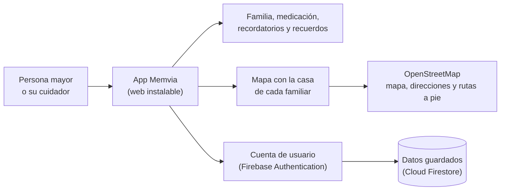
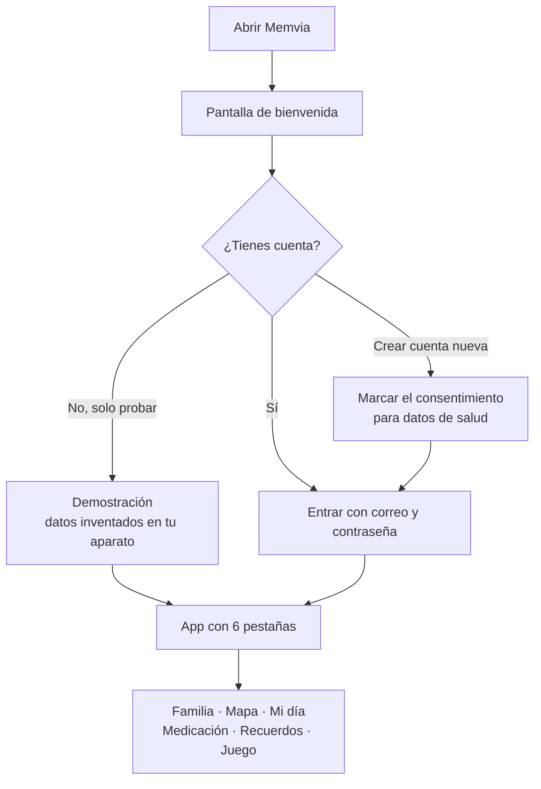
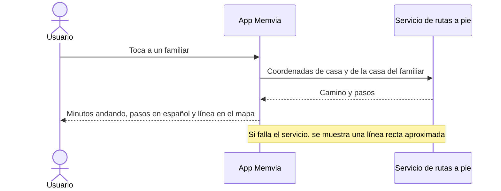
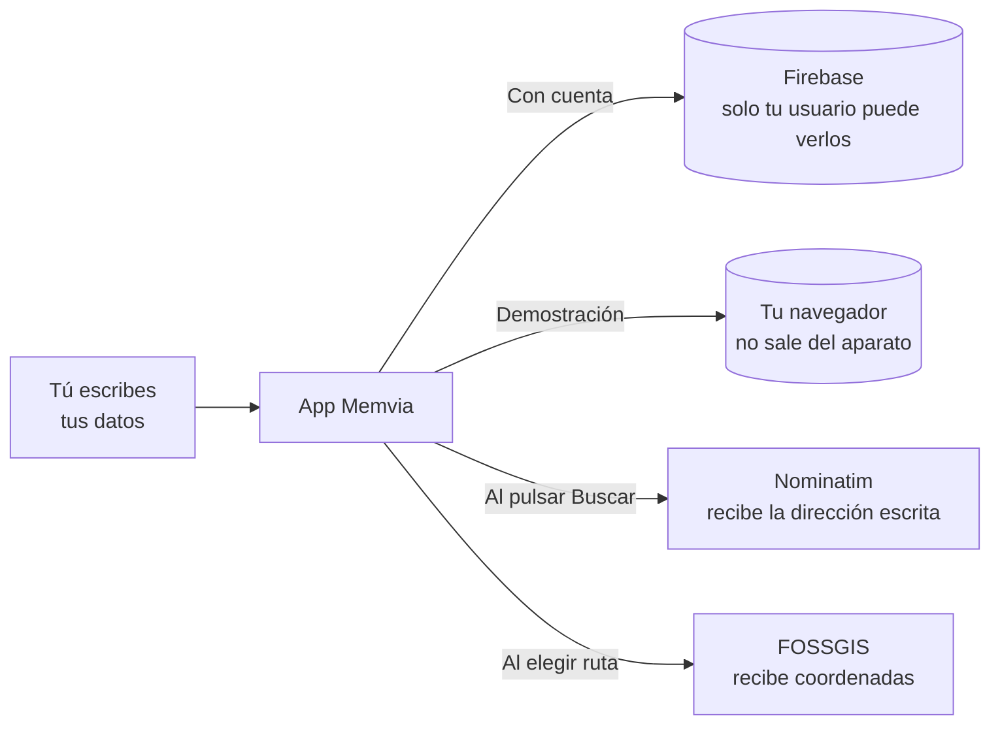

<div align="center">


# Memvia · Tu gente, siempre cerca

**App web instalable para personas con pérdida de memoria (alzheimer, demencia, amnesia o vejez):**
reconocer a la familia, saber dónde vive y recordar el día.

[**▶ Probar la demo**](https://alejandro22410.github.io/prueba/) · [Instalarla](#-instalarla-como-app) · [Privacidad](privacidad.html)

  -0B6560) 

**Proyecto para Coolest Projects** · Alejandro Narvaez Jaime · Codelearn Gava

</div>

---

## Índice

[Qué hace](#-qué-hace) · [Cómo funciona](#-cómo-funciona) · [Probarla](#-probarla) · [Instalarla](#-instalarla-como-app) · [Tu propio Firebase](#-poner-tu-propia-cuenta-de-firebase) · [Avisos](#-avisos) · [Accesibilidad](#-accesibilidad) · [Archivos](#-archivos) · [Privacidad](#-privacidad-y-legal) · [Límites](#-límites) · [Ideas futuras](#-ideas-futuras)

## 🧠 El problema

Una persona con pérdida de memoria puede olvidar quién es cada familiar, dónde vive o si ya tomó su pastilla. Memvia pone todo eso en una pantalla grande y sencilla: la **cara y el nombre** de cada familiar, **dónde vive** en un mapa real, el **camino a pie** desde casa, la medicación y las tareas del día. Lo prepara un familiar o cuidador, y la persona solo tiene que tocar.

## ✨ Qué hace

| | Función |
|---|---|
| 👨‍👩‍👧 **Familia** | Foto (o icono), nombre, parentesco y una frase especial. Un toque y la app lo **lee en voz alta**. Llamada y WhatsApp con un botón. |
| 🗺️ **Mapa real** | OpenStreetMap con la casa de cada familiar y lugares importantes (farmacia, centro de salud…). Al tocar uno: minutos **andando** y pasos del camino en español. Hay también un **esquema** de distancias. |
| 📅 **Mi día** | Tareas con hora, aviso de voz y notificación. Lo que pasa sin marcar sale en «Se te ha pasado hoy». |
| 💊 **Medicación** | Horarios y registro de tomas. |
| ❤️ **Recuerdos** | Pequeñas historias de la familia. |
| 🎮 **Juego «¿Quién es?»** | Ejercita la memoria con las caras de la familia. |
| 🆘 **SOS** | Llama a un familiar. |
| 🔠 **Fácil de leer** | Modo simple, letra grande, tema claro / oscuro / automático, botones grandes. |
| ☁️ **Cuentas** | Con Firebase, un cuidador prepara los datos y se ven en otro dispositivo. |
| 🧪 **Demostración** | Sin cuenta y con datos inventados, solo en ese aparato. |
| 📲 **PWA** | Se instala en el móvil y abre sin internet para ver lo ya guardado. |

## 🧩 Cómo funciona

**Las piezas de Memvia**



**Qué pasa al abrir la app**



**Qué pasa al tocar a un familiar en el mapa**



**A dónde van los datos**



## 🚀 Probarla

**Online:** <https://alejandro22410.github.io/prueba/> → pulsa **Probar sin cuenta (demostración)**.

**En tu ordenador**, con cualquier servidor estático (no hay paso de compilación):

```bash
python3 -m http.server 8080      # o: npx serve
```

y abre <http://localhost:8080>.

## 📲 Instalarla como app

- **Android (Chrome):** menú ⋮ → *Instalar aplicación*.
- **iPhone (Safari):** Compartir → *Añadir a pantalla de inicio*.
- **APK:** en <https://www.pwabuilder.com> pega la dirección https de la app y descarga el paquete para Android.

## 🔥 Poner tu propia cuenta de Firebase

1. En <https://console.firebase.google.com> crea un proyecto y activa **Authentication → Correo y contraseña** y **Firestore**.
2. Copia la configuración web en `js/config.js`.
3. En Firestore → Reglas (en algunas consolas, *Seguridad*), pega el contenido de `firestore.rules`. Así cada persona solo lee y escribe **sus** datos.
4. En Authentication → Configuración → Dominios autorizados, añade el dominio donde publiques la app.

## 🔔 Avisos

Las tareas y la medicación suenan **con voz** y, si se activan en Ajustes, con **notificación del aparato**. Si abres Memvia tarde, los avisos pasados no se leen de golpe: aparecen en «Se te ha pasado hoy» con un botón para marcarlos.

Funcionan con la app **abierta o en segundo plano**. Con la app cerrada del todo, un navegador no puede avisar sin un servidor (haría falta Firebase Cloud Messaging con Cloud Functions, que exige el plan de pago Blaze). Por eso, en Ajustes → **«Llevar los avisos a mi calendario»** crea un archivo `.ics` con una alarma diaria: el calendario del móvil sí avisa con Memvia cerrada.

## ♿ Accesibilidad

Pensada para personas mayores: campos con etiqueta, pestañas con teclado (flechas), ventanas con foco y Escape, fichas que se abren con teclado, contraste ≥ 4,5:1, zonas táctiles ≥ 44 px, sin scroll horizontal a 320 px y respeto de «reducir movimiento».

> Revisada con comprobaciones automáticas propias (WCAG 2.1 AA). **No** se ha probado con lectores de pantalla reales (VoiceOver, TalkBack, NVDA): pruébala con uno antes de darla por buena.

## 🗂️ Archivos

| Archivo | Función |
| --- | --- |
| `index.html` | Pantallas y diálogos |
| `css/styles.css` | Diseño, temas claro y oscuro, tamaños táctiles |
| `js/app.js` | Lógica: familia, mapa, rutas, medicación, cuentas, modo demo |
| `js/mapa.js` | Mapa Leaflet y marcadores |
| `js/buscador.js` | Buscador de direcciones (eliges tú el resultado correcto) |
| `js/avisos.js` | Qué aviso toca ahora, cuáles se perdieron y exportación `.ics` |
| `js/geo.js` | Direcciones (Nominatim) y rutas a pie (OSRM), con ruta aproximada si falla |
| `js/demo.js` | Datos de ejemplo inventados |
| `js/config.js` | Configuración de Firebase |
| `sw.js`, `manifest.webmanifest` | Instalación, modo sin conexión y clic en notificaciones |
| `firestore.rules` | Reglas de seguridad de la base de datos |
| `privacidad.html` | Política de privacidad, bases legales y aviso legal |

**Tecnologías:** HTML, CSS y JavaScript (módulos) sin build · Leaflet + OpenStreetMap · Nominatim · OSRM (FOSSGIS) · Firebase Auth y Firestore · Service Worker.

## 🔒 Privacidad y legal

- `privacidad.html` incluye política de privacidad, bases legales (RGPD y LOPDGDD), derechos, destinatarios, cookies y aviso legal.
- El responsable es Alejandro Narvaez Jaime (proyecto educativo) y el contacto es por «Issues» de GitHub, sin correo ni domicilio publicados. Si lo publicas como servicio real, cambia estos datos por los de una persona o entidad responsable.
- Al crear una cuenta hay una casilla de **consentimiento explícito** para datos de salud (medicación), guardada con la versión de la política y la fecha. Si una cuenta antigua no lo tiene, la app lo pide al entrar.
- En Ajustes: **Exportar copia** (portabilidad) y **Eliminar mi cuenta** (borra datos y usuario).
- Sin cuenta (demostración) nada sale del dispositivo, salvo búsquedas de dirección y rutas.
- Con cuenta, los datos están en Firebase (Google, región de Europa), sin cifrado de extremo a extremo. `firestore.rules` limita cada documento a su dueño.
- Al mapa se envían a terceros la IP y, al pulsar Buscar o elegir ruta, la dirección o las coordenadas (Nominatim, FOSSGIS).
- Usa datos inventados, o permiso de la familia, en demos públicas.
- Si la app llega a muchas personas (datos de salud de personas vulnerables a gran escala), hace falta además una evaluación de impacto (art. 35 RGPD) y un registro de actividades de tratamiento. Consulta con un asesor jurídico o con el delegado de protección de datos de tu centro.

## ⚠️ Límites

- Memvia ayuda a recordar y orientarse. **No es un sistema de seguridad ni de emergencias** (en una emergencia, llama al 112) y no sustituye a un cuidador ni a un médico.
- Los avisos no son fiables con la app cerrada del todo (ver [Avisos](#-avisos)).
- Las fotos se guardan dentro del documento de Firestore (~1 MB). Con muchas fotos grandes la app avisa y no guarda.
- Los servicios gratuitos de OpenStreetMap, Nominatim y FOSSGIS son para poco volumen.
- Los pasos de la ruta se traducen con reglas sencillas; algunas calles pueden sonar raras. Revisa las rutas reales antes de fiarte.
- El mapa, las búsquedas y las rutas necesitan internet.
- No se ha probado con lectores de pantalla ni en todos los móviles y navegadores.

## 🔭 Ideas futuras

- Avisos con la app cerrada mediante Firebase Cloud Messaging.
- Videollamada al familiar desde su ficha.
- Que el cuidador edite desde su móvil y la persona lo vea al momento en su tableta, con permisos por rol.
- Más idiomas (catalán, inglés).

## 🙏 Créditos

Hecho por **Alejandro Narvaez Jaime** (Codelearn Gava) para Coolest Projects.
